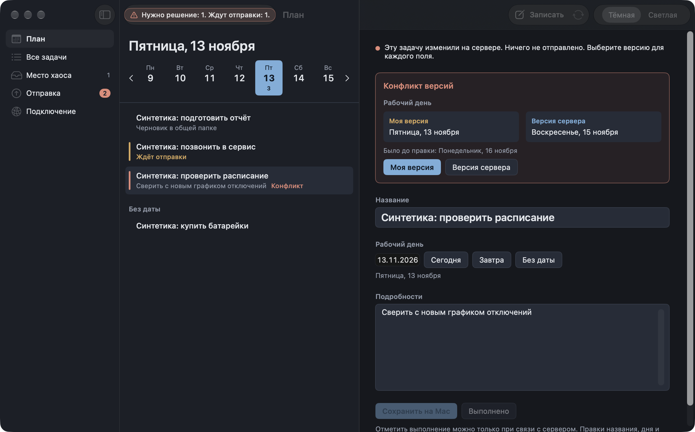

# «Хаос Дня План»: экспериментальный клиент Mac

Отдельное приложение на SwiftUI, написанное с нуля. Старое приложение (`../Sources`, `../Resources/Info.plist`) не изменено и в сборку не входит, из корня берётся только иконка `../Resources/AppIcon.icns`.

| | |
|---|---|
| Бандл | `Хаос Дня План.app`, bundle ID `local.chaosday.plan.pilot`, исполняемый файл `ChaosDayPlan` |
| Данные | `~/Library/Application Support/ChaosDayPlanPilot/`, переопределяются через `CHAOS_PLAN_DATA_DIR` или `--data DIR` |
| Пароль | не сохраняется. Cookie сессии живёт только в памяти процесса (эфемерный `URLSession`, cookie-хранилище отключено) |
| Сеть | обычный `http` разрешён только для loopback (`127.*`, `localhost`, `::1`), для остальных адресов нужен `https`. Перенаправления не выполняются |



## Сборка и проверки

```bash
./plan-client/test.sh    # самопроверка SyncCore против сервера в памяти + сборка build/plan/chaos-sync
./plan-client/build.sh   # build/plan/Хаос Дня План.app и build/plan/Chaos-Day-Plan-Pilot.zip (ad hoc подпись)
```

Нужны только Command Line Tools: Xcode не требуется. Если в CLT нет плагина `SwiftUIMacros`, `sdk.sh` выбирает `MacOSX26.5.sdk`.

## Что есть в первой сборке

- **Навигация**: «План», «Все задачи», «Место хаоса», «Отправка», «Подключение».
- **«План»** — выбранный день крупно, компактная неделя (пн–вс) с числом открытых задач на каждый день, задачи дня и задачи без даты.
- **Редактор выбранной задачи** — название, рабочий день («Сегодня», «Завтра», «Без даты» или дата), подробности. День сохраняется сразу. Название и подробности сохраняются по Enter, при уходе из поля или по «Сохранить на Mac» (⌘S).
- **Правка до сети**: правка записывается в `servers/<сервер>/state.json` и только потом уходит в сеть. В строке статуса видно, где правка: «Ждут отправки», «Нет связи», «Нужен вход», «Офлайн включён», «Нужно решение», «Всё отправлено».
- **Безопасная отправка**: очередь отправляется каждые 10 секунд и сразу при возвращении сети (`NWPathMonitor`). Запрос сначала помечается на диске как неподтверждённый. Если ответ потерян, тот же запрос повторяется дословно, и сервер признаёт повтор по совпадению с `changes`.
- **Конфликт**: показываются «Моя версия», «Версия сервера» и значение до правки. Решение принимается по каждому полю. Пока решения нет, ничего не отправляется.
- **404 и 400** остаются в очереди с пояснением до явного «Убрать правку». 401, обрыв сети и 5xx очередь не трогают.
- **Смена сервера**: у каждого сервера своя копия и своя очередь. Правки прежнего сервера не уходят на новый, они видны в «Отправке» в группе «На других серверах».
- **Офлайн-переключатель** в «Подключении» и в меню «Синхронизация» (⇧⌘O) сохраняется между запусками.
- **Тема «Тёмная / Светлая»** — переключатель в панели инструментов, в «Подключении» и в меню «Вид → Оформление». По умолчанию тёмная. Выбор хранится в `ui.json` каталога данных и действует до входа.
- **Базовый сценарий, только при связи**: «Записать» (⇧⌘N, `POST /api/chaos`), «Место хаоса» → «В задачу» / «В заметку», «Выполнено» / «Вернуть в работу». Эти действия не ставятся в очередь и не имитируются: без связи кнопки неактивны и объясняют причину.

Не вошло: создание задач напрямую, проекты, ожидания, обзор, заметки, поиск, правка других полей задачи.

## Протокол

`POST /api/auth/login` → cookie `chaos_day_session`; `GET /api/tasks?show_completed=1&show_removed=1`; `GET /api/tasks/:id`; `POST /api/sync/tasks/:id` с `{base, changes}` для полей `day`, `text`, `details`. Значения нормализуются как на сервере: обрезка пробелов, пустые подробности → `null`, UUID в нижнем регистре.

## CLI для приёмки: `build/plan/chaos-sync`

Тот же SyncCore, что в приложении. Каждый каталог `--data` — отдельный клиент. Пароль берётся только из `CHAOS_SYNC_PASSWORD`. Вывод — JSON в stdout. Коды выхода: `0` — успех, `1` — ошибка или остановка с непустой очередью, `2` — неверный вызов, `3` — есть правки, ждущие решения.

```bash
export CHAOS_SYNC_PASSWORD=…   # пароль тестового сервера
C=build/plan/chaos-sync
$C --data /tmp/A --server http://127.0.0.1:3100 pull
$C --data /tmp/A edit ID --day 2026-11-15          # также --no-day, --text T, --details D, --clear-details
$C --data /tmp/A offline on|off
$C --data /tmp/A push [--offline]
$C --data /tmp/A sync                              # push, затем pull
$C --data /tmp/A status | list
$C --data /tmp/A resolve ID day mine|server
$C --data /tmp/A discard ID
```

Примеры реального вывода лежат в [`docs/examples/`](docs/examples): `pull`, `edit` в офлайне, `status` и `list` с очередью, `push` с 409, `push` после «Моя версия».

Межклиентский прогон (два клиента, A и B):

```bash
CHAOS_SYNC_PASSWORD=… python3 -I plan-client/Tools/e2e-cli.py --bin build/plan/chaos-sync --server http://127.0.0.1:3100
```

`Tools/stub-server.py` — временный сервер в памяти: только loopback, синтетические данные. Нужен для проверки клиента, пока нет настоящего сервера. С флагом `--stub` прогон добавляет сценарий потерянного ответа через тестовую ручку этого сервера.

## Запуск приложения на изолированных данных

```bash
open -n "build/plan/Хаос Дня План.app" --args --data /tmp/plan-A
# необязательно: --section plan|all|chaos|outbox|connection --day 2026-11-13 --select ID
```

Ключевые элементы доступны по accessibility identifier: `status-pill`, `theme-picker`, `capture-button`, `sync-now`, `week-day-ГГГГ-ММ-ДД`, `week-prev`, `week-next`, `task-row-ID`, `editor-title`, `editor-day`, `editor-day-none`, `editor-details`, `editor-save`, `editor-sync-state`, `conflict-mine-day`, `conflict-server-day`, `server-field`, `login-password`, `login-button`, `offline-toggle`.

Проверка темы после перезапуска: выбрать «Светлая», закрыть приложение, открыть с тем же `--data`. В `DIR/ui.json` записано `"theme" : "light"`, окно открывается светлым.
